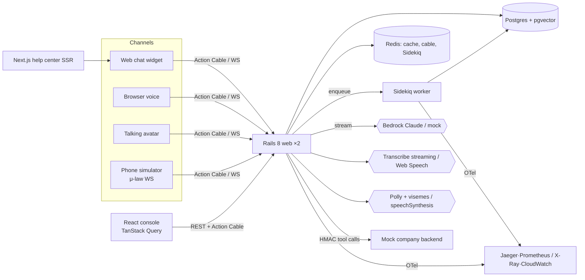

# AI Agent Desk

[](https://github.com/mini4141/ai-agent-desk/actions/workflows/ci.yml)

A multi-channel AI customer-support platform. Companies plug **their own knowledge and workflows** into one Rails platform; AI agents answer customers over
**web chat, browser voice, a talking avatar and a simulated phone line**, fast enough to feel natural, and hand off to **human operators** when needed.
Every turn is measured against a latency budget, business metrics (deflection, handoff, CSAT, handle time) roll up daily, and a Flipper A/B experiment proves a change helped.

- Proof index: [`proof/README.md`](proof/README.md) · Write-up: [`docs/PORTFOLIO.md`](docs/PORTFOLIO.md) · Specs: [`SPECS.md`](SPECS.md) · Rules: [`CLAUDE.md`](CLAUDE.md)

## Architecture



## Quickstart (local, no AWS)

Prerequisites: Docker Desktop, Node 24 + pnpm, k6 (for the load test). Ruby runs in Docker, so no host Ruby is needed.

```bash
scripts/dev-up.sh        # docker compose (Rails web+Sidekiq, Postgres/pgvector, Redis, mock company backend, Jaeger, OTel, Prometheus, Grafana) + Vite/Next dev servers
scripts/test-all.sh      # RSpec, tsc, Vitest, Playwright e2e, k6 latency smoke -> proof/phase1-local/tests/
scripts/capture-proof.sh phase1-local   # screenshots + logs -> proof/phase1-local/
scripts/dev-down.sh
```

| URL | What |
|---|---|
| http://localhost:3001/mirai/help | Help center (Next.js SSR, Japanese) with the embedded widget; `/harbor/help` is the English company |
| http://localhost:5173 | Operator/admin console (`sato@mirai.example` operator, `owner@mirai.example` owner; password `agentdesk-demo`) |
| http://localhost:5175 | Phone-line simulator |
| http://localhost:16686 · :9090 · :3030 | Jaeger · Prometheus · Grafana |

`LLM_PROVIDER=mock`, `SPEECH_PROVIDER=browser`, `EMBEDDING_PROVIDER=mock` locally (copy `.env.example`); set them to `bedrock` / `aws` / `bedrock` for real AWS services.

## Deploy / destroy (AWS, `ap-southeast-2`)

```bash
scripts/deploy.sh                      # build + push images, terraform apply, migrate + seed, smoke test
scripts/capture-proof.sh phase2-cloud  # cloud screenshots + tests
scripts/destroy.sh && scripts/verify-destroyed.sh
```

Deployment from CI uses GitHub OIDC (`.github/workflows/deploy.yml`, `infra/github-oidc/`) with an ECS rolling deploy, deployment circuit breaker and automatic rollback.
All resources are tagged `Project=ai-agent-desk`, run only for the showcase, and are destroyed afterwards.

## Repository map

| Path | Contents |
|---|---|
| `app/` | Rails: `agents/` (AgentRun, retrieval, LLM + speech providers), `channel_adapters/`, `channels/`, `controllers/`, `jobs/`, `policies/`, `services/` |
| `web/console` · `web/widget` · `web/phone-sim` · `web/help-center` · `web/e2e` | React console, Shadow-DOM widget, phone simulator, Next.js help center, Playwright tests |
| `mocks/` | Mock company backend (Sinatra; signed order/callback tools) + the demo FAQ sites that get ingested |
| `infra/` | Terraform (network, ECS, RDS, ElastiCache, S3, CloudFront, ECR, alarms, GitHub OIDC) |
| `observability/` | OTel collector, Prometheus, Grafana |
| `docs/` | ADRs, runbooks, postmortems, experiment write-up, `db-performance.md`, `DECISIONS.md`, `AI_USAGE.md` |
