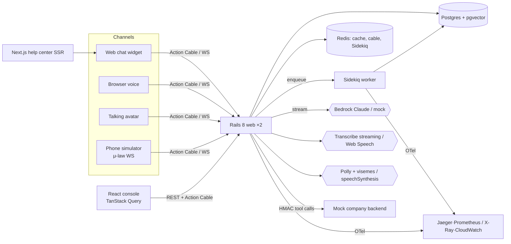

# SPECS.md: AI Agent Desk

## 1. Summary

AI Agent Desk is one platform for **people-facing AI work**: sales questions, customer support and simple interviews. Companies (tenants) connect their **own knowledge** (FAQ pages, manuals) and **workflows** (order lookup, callback booking) through HTTP tools.

The same AI agent then serves customers on four channels:

| Channel | How it works |
|---|---|
| Web chat widget | Text chat embedded in the company's site |
| Browser voice | Microphone in the browser, spoken replies |
| Talking avatar | Lip-synced to Polly visemes |
| Phone line (simulated) | A μ-law audio stream that looks like a real phone line |

Responses stream fast enough to feel natural, and every turn is measured against a **latency budget**. When the AI isn't confident, or the customer asks for a person, the conversation goes to a **human operator**, who sees it live with an AI-drafted reply. **Business metrics** (deflection, handoff, CSAT, handle time) roll up daily, and an A/B experiment shows a feature improving them.

**Demo story:**
1. A Japanese electronics retailer, 「ミライ電機」, connects its FAQ and an order-status API.
2. A customer asks in Japanese chat, 「注文 A-1023 はいつ届きますか？」. The agent calls `check_order_status` and answers with a citation, with the first token in about 600 ms.
3. The same question over voice, then the avatar, and then the phone simulator.
4. A customer asks for a person. Operator Sato takes over in the console, sends the AI-drafted reply, then hands back.
5. The dashboard shows that deflection went up under `greeting_v2`.

## 2. Requirement coverage matrix

| Requirement | Covered by | Proof |
|---|---|---|
| Technical ownership end to end across frontend, backend and data | Rails core + React console + Next.js help center + Postgres/Redis data layer | Repo + e2e |
| Architecture design and technology decisions | `docs/adr/` (channel adapter design, pgvector vs a dedicated vector DB, Action Cable vs a separate WS service, streaming strategy) | Docs |
| Scalability, maintainability, performance | Stateless web tasks ×2, Sidekiq offload, Redis caching, latency budget | k6 + dashboard |
| Scalable backend in Rails (5y+) | Rails 8 API, Action Cable, Sidekiq | RSpec |
| Modern web apps with React (TS) | Console + widget | Vitest/Playwright |
| Production DB optimisation, query tuning | `docs/db-performance.md`, strict loading, Bullet, HNSW + composite indexes | Doc |
| CI/CD design + automated testing | GitHub Actions test + OIDC deploy with automatic rollback | Workflow runs |
| Monitoring, logging, performance optimisation | OTel traces, lograge, Prometheus/Grafana, CloudWatch alarms, latency dashboard | Screenshots |
| Security: authn, authz, data protection | Rails auth + JWT, Pundit, AR encryption, PII redaction, rate limits | RSpec |
| Shipping features that improved business metrics or UX | `greeting_v2` experiment with measured delta | Experiment doc + dashboard |
| Japanese collaboration | ja-first UI, prompts, seed data, Japanese voices | Screenshots |
| Tech env: Rails, React + TS, PostgreSQL + Redis, ECS, GitHub automated deploy | All | Proof |
| Preferred: SSR (Next.js), TanStack Query, observability (APM + tracing), HA ops + incident response, AI-assisted dev | Help center, console, OTel/X-Ray, runbooks + drill postmortem, `docs/AI_USAGE.md` | — |
| Product areas: Shopping, Avatar, Customer Support; real-time voice/video; multi-channel phone→web; natural latency; company-specific data/workflows | Channels F3–F6, latency budget F8, knowledge + workflow tools F2 | Screenshots + logs |

## 3. Architecture



## 4. Repository layout

```
app/                     Rails (models, controllers/api, channels/, agents/, channel_adapters/, tools/, jobs/, policies/)
config/  db/             migrations, seeds (2 companies: ja + en)
web/console/             React + Vite + TanStack Query
web/widget/              React widget (chat / voice / avatar)
web/help-center/         Next.js
web/phone-sim/           phone-line simulator page
mocks/company-backend/   mock order/callback API (small Sinatra or Rails app)
mocks/demo-sites/        static FAQ sites to ingest
infra/                   Terraform (network, ecs, rds, redis, s3, cloudfront, github-oidc)
.github/workflows/       ci.yml, deploy.yml
observability/           otel-collector.yaml, prometheus.yml, grafana dashboards
docs/                    adr/, runbooks/, postmortems/, experiments/, db-performance.md, DECISIONS.md, AI_USAGE.md, PORTFOLIO.md
```

## 5. Features (end-to-end)

### F1: Companies, users and roles
- Companies (tenants) have users with the roles `owner`, `admin` and `operator`. Sign-in uses Rails auth with a session cookie for the console and JWT for the API. Each company has an API key for the widget and an allowed-origins list.
- **Accept:** an operator can't open admin settings (Pundit), and a request spec proves company A can't read company B's conversations.

### F2: Knowledge and workflow tools (company-specific data)
- **Knowledge:** add a source (demo-site URL, Markdown or PDF upload to S3). A Sidekiq job crawls or parses it, chunks it, embeds it and stores it in pgvector. The console lists sources with their status and chunk counts.
- **Tools:** the admin defines HTTP tools (name, description, JSON-schema params, endpoint, HMAC secret). They're seeded for the demo: `check_order_status(order_id)` and `book_callback(phone, time)` against the mock backend.
- **Accept:** the demo FAQ is ingested (≥ 50 chunks), and a tool test call from the console returns the mock response.

### F3: Web chat channel (streaming)
- The widget opens an Action Cable `ConversationChannel`. Each customer message runs `AgentRun`:
  1. Language detection.
  2. Cache check (Redis, keyed by company + normalised question).
  3. Retrieval (top-k chunks).
  4. Bedrock streaming with tools.
  5. Tokens stream to the client.
  6. Citations attached.
- **Accept:** an answer streams with a citation link, and the tool call is visible in the conversation's trace.

### F4: Browser voice channel
- Hold-to-talk sends PCM frames over Action Cable. In the cloud they go to Transcribe streaming (partials shown live); locally the browser's Web Speech API transcript is used. The agent replies, TTS starts on the first sentence (Polly in the cloud, `speechSynthesis` locally) and audio streams back.
- **Accept:** Playwright with the `--use-fake-device-for-media-stream` plus a fake audio file flags gets a spoken reply. Locally, record the mock path.

### F5: Talking avatar channel
- The same pipeline as voice. Polly speech marks (`viseme`) drive an SVG face's mouth shapes, synced to the audio timeline; locally, a simple amplitude-based mouth animation. "Interview mode" asks a scripted 3-question intake (for example, about a product return) and fills a structured form.
- **Accept:** the avatar speaks the answer and the interview fields are stored on the conversation.

### F6: Phone channel (simulated)
- The phone simulator page captures mic audio, downsamples it to 8 kHz μ-law and sends `start` / `media` / `stop` events like a telephony media stream. The Rails `PhoneSimAdapter` decodes them and joins the voice pipeline, then returns μ-law audio frames. Barge-in: new caller audio cancels the current TTS.
- **Accept:** a call completes one question and answer, and the conversation shows `channel = phone_sim`.

### F7: Human handoff and operator console
- Escalation triggers: low retrieval confidence, an intent such as "talk to a human" / 「人と話したい」, or a sensitive topic.
- The console inbox (TanStack Query with live invalidation over Action Cable) lists open conversations by priority. In the conversation view, the operator gets the live transcript, an AI-drafted reply (editable), Send, Hand back to AI, Resolve, and tags.
- **Accept:** in the e2e test the escalated conversation appears in the inbox in under 2 s, and the operator's message reaches the customer's widget.

### F8: Latency budget and performance
- Per-turn timings are stored on `messages` and exported as metrics. The "Latency" dashboard shows p50/p95 per stage per channel against the budget, plus the cache hit rate.
- **Accept:** the k6 chat test (20 virtual users × 2 minutes, mock LLM) holds a time-to-first-token p95 under 400 ms locally. The cloud numbers with Bedrock are recorded as they are.

### F9: Business metrics and the experiment
- Rollups: deflection (resolved without a human), handoff rate, CSAT, average handle time, and tool-conversion rate, per day, channel and variant.
- `greeting_v2` (Flipper, 50/50 sticky by visitor) shows suggested questions on open. The seed script simulates about 400 conversations with realistic variance so the dashboard has data, and the e2e test adds real ones.
- **Accept:** the dashboard shows both variants with deltas, and `docs/experiments/greeting-v2.md` reports the result.

### F10: Help center (Next.js SSR)
- `/{company}/help` lists articles server-rendered from the knowledge sources (`generateMetadata` for SEO), with search and the widget embedded. In Japanese for the ja company.
- **Accept:** the page HTML contains the article text without JavaScript (a curl check), and the widget loads.

### F11: Reliability drill
- `scripts/drill-kill-web-task.sh` stops one web container or task during an active chat. The client reconnects and the conversation continues. The drill log feeds the `docs/postmortems/` write-up.

## 6. Data model

- `companies(id, name, locale, api_key_digest, allowed_origins[], settings jsonb)`
- `users(id, company_id, email, password_digest, role)`
- `knowledge_sources(id, company_id, kind, url, s3_key, status, chunks_count)`
- `knowledge_chunks(id, company_id, source_id, content, embedding vector(1024), metadata jsonb)`: HNSW index, plus a `(company_id)` btree
- `tools(id, company_id, name, description, params_schema jsonb, endpoint, encrypted_secret)`
- `conversations(id, company_id, channel, status{ai,waiting_human,human,resolved}, assignee_id, variant, csat, started_at, resolved_at, messages_count)`
- `messages(id, conversation_id, role{customer,ai,operator,tool}, content, citations jsonb, timings jsonb, created_at)`: composite index `(conversation_id, created_at)`
- `metric_rollups(id, company_id, day, channel, variant, metrics jsonb)`

## 7. Interfaces

- **REST** (`/api/v1`, JWT):
  - `companies/me`
  - `knowledge_sources` (+ `/:id/reindex`)
  - `tools` (+ `/:id/test`)
  - `conversations` (+ `/:id/assign`, `/:id/handback`, `/:id/resolve`, `/:id/messages`)
  - `metrics?from&to&channel&variant`
  - `experiments`
- **Widget** (public key): `POST /widget/v1/sessions`, `POST /widget/v1/conversations/:id/csat`
- **Action Cable channels:** `ConversationChannel`, `VoiceChannel` (audio frames), `InboxChannel` (operators)
- **WebSocket:** `/phone-sim/stream` (telephony-media-stream-shaped JSON)
- **Health:** `/up`

## 8. Test plan

See CLAUDE.md §7. CI runs RSpec, Vitest and Playwright with the mock LLM and mock speech.

## 9. Phase 1: Local

`docker compose` runs postgres (pgvector image), redis, jaeger, otel-collector, prometheus, grafana, the mock company backend and the demo sites. Then Rails (puma + sidekiq), Vite console, Next.js help center and the phone simulator. `LLM_PROVIDER=mock` and `SPEECH_PROVIDER=browser`.

- [ ] `tests/`: RSpec JUnit, Vitest, Playwright report, k6 summary
- [ ] `screenshots/01-chat-ja-streaming-citation.png`, `02-tool-call-order-status.png`, `03-voice-widget.png`, `04-avatar-interview.png`, `05-phone-sim.png`, `06-console-inbox.png`, `07-operator-takeover.png`, `08-latency-dashboard.png`, `09-metrics-experiment.png`, `10-help-center-ssr.png`, `11-jaeger-trace.png`, `12-knowledge-sources.png`
- [ ] `logs/drill-kill-web.log`, `logs/curl-help-center-ssr.html`, `docs/db-performance.md` (real EXPLAIN), `docs/experiments/greeting-v2.md`

## 10. Phase 2: AWS

| Local | AWS |
|---|---|
| puma / sidekiq / next containers | ECS Fargate services: web ×2 (2 AZs), worker ×1, help-center ×1, behind an ALB (WebSockets, sticky not required) |
| Vite console | S3 + CloudFront (API base = ALB) |
| pgvector Postgres | RDS PostgreSQL 17 with `CREATE EXTENSION vector` |
| Redis | ElastiCache Redis OSS |
| mock LLM / browser speech | Bedrock (Claude + Titan embeddings), Transcribe streaming, Polly (Japanese + English neural voices with viseme speech marks) |
| Jaeger / Prometheus | ADOT sidecar → X-Ray; CloudWatch metrics, alarms, dashboard |
| local secrets | Secrets Manager (`RAILS_MASTER_KEY`, DB/Redis URLs) |
| local deploy | **GitHub Actions `deploy.yml` via OIDC**: build → push to ECR → `terraform apply` (image tag var) → ECS rolling deploy with circuit breaker → smoke test (fallback: `scripts/deploy.sh`) |

The mock company backend and the demo sites also run as small ECS services (they're part of the demo).

- [ ] `logs/gh-actions-deploy-run.txt` (`gh run view --log`, redacted), `logs/ecs-deployment-rollback-demo.txt` (deploy a deliberately broken image tag → the circuit breaker rolls back)
- [ ] `screenshots/01-cloud-chat-bedrock.png`, `02-cloud-voice-transcribe-polly.png`, `03-cloud-avatar-visemes.png`, `04-cloud-operator.png`, `05-cloud-latency.png`, `06-cloudwatch-alarms.png` (via `get-metric-widget-image`), `07-xray-trace-summary.png`
- [ ] `tests/playwright-cloud/`, `tests/k6-cloud.txt`, `resources.txt`

## 11. Phase 3: Destroy

`scripts/destroy.sh`:
1. Scale the services to 0.
2. Empty the buckets and ECR.
3. `terraform destroy` (including the GitHub OIDC role, and the provider only if this project created it).

`verify-destroyed.sh` checks for no ECS cluster, ALB, RDS instance, ElastiCache cluster, CloudFront distribution, S3 buckets, ECR repos, Secrets Manager secrets or `ai-agent-desk` IAM roles.

## 12. Out of scope

Real PSTN numbers or telephony carriers, real-time video avatars (rendered video), SSO, billing, and multi-region.
