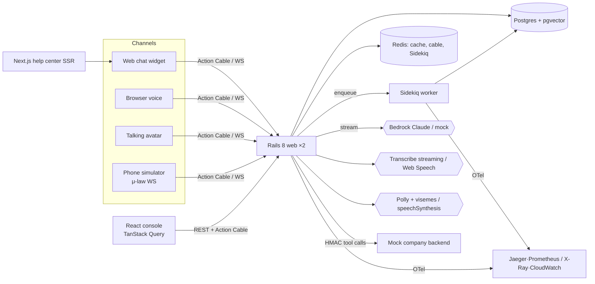
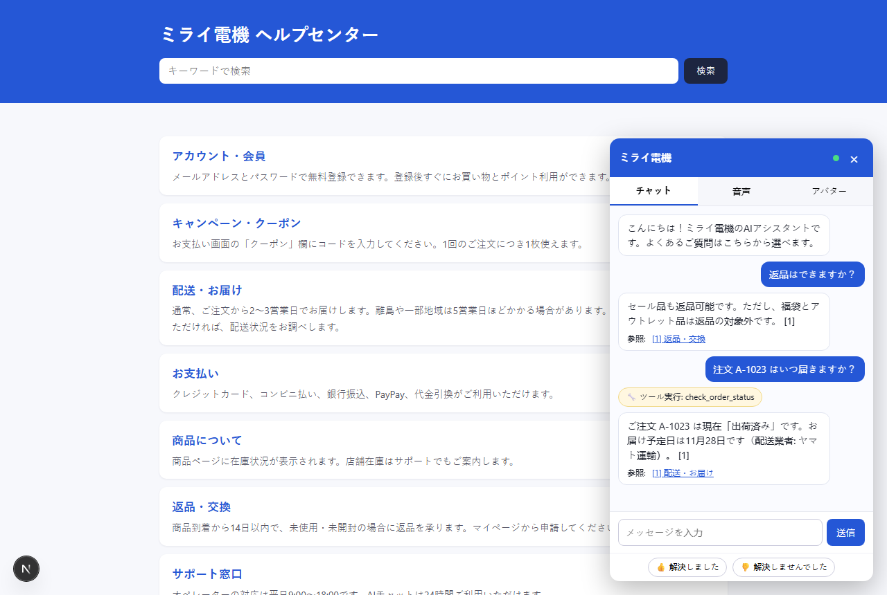
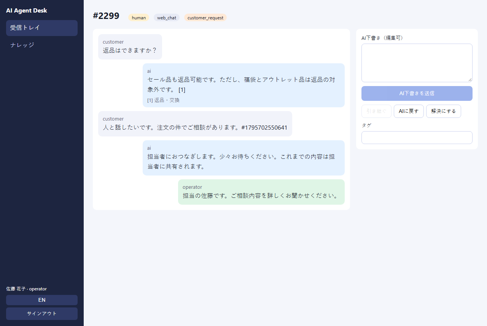
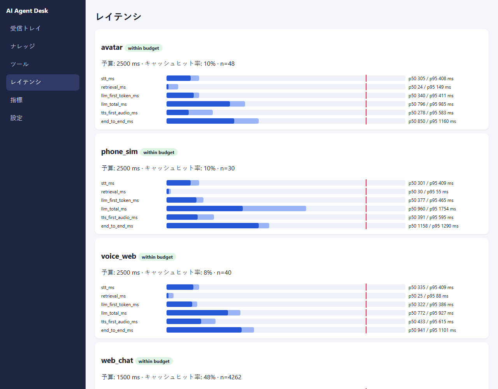
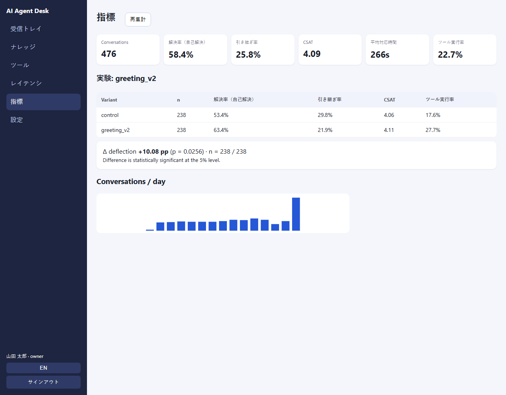
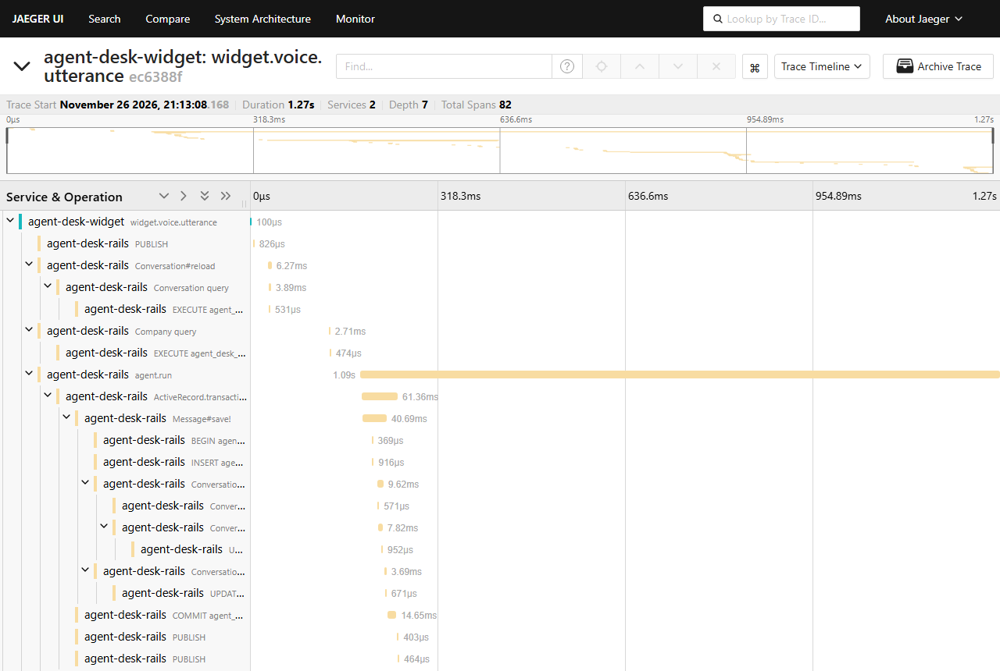
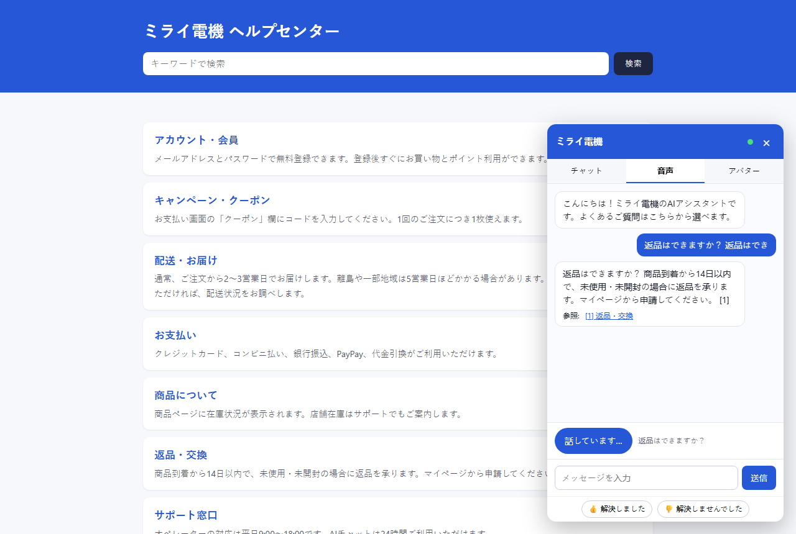
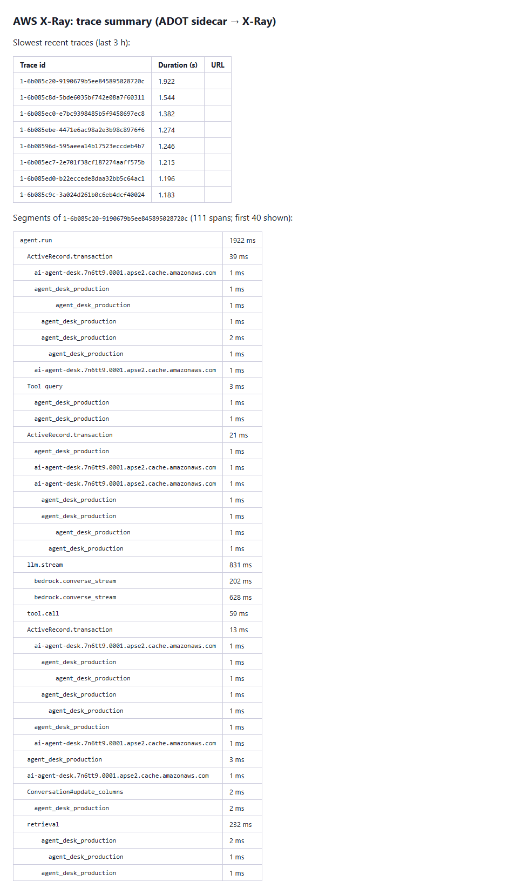
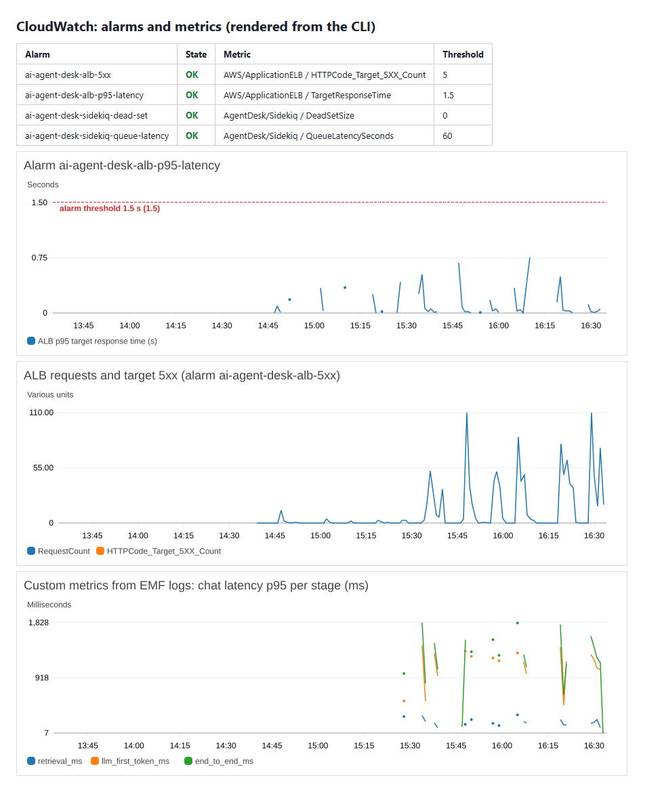

# AI Agent Desk — one Rails platform, four customer channels, measured latency

*A multi-channel AI customer-support platform (Rails 8, React 19, PostgreSQL + pgvector, Redis, Sidekiq, AWS ECS Fargate). Source: `ai-agent-desk` repository; evidence: [`proof/README.md`](../proof/README.md).*

## The problem

Companies want an AI agent that answers customers from **their own** knowledge and workflows — on the web, by voice, through a talking avatar and on the phone — fast
enough to feel natural, and hand the conversation to a person when the AI should not carry on. They also need proof that it works: deflection, CSAT, handle time,
and an experiment framework that says whether a change helped.

## What I built

- **One agent core, many channels.** `Conversation` + `Message` + `AgentRun`; the four channels (`web_chat`, `voice_web`, `avatar`, `phone_sim`) are adapters that turn input into text turns and render output as tokens, TTS audio + visemes, or 8 kHz μ-law frames. Adding the phone channel did not touch the core ([ADR 0001](adr/0001-channel-adapters.md)).
- **Company-specific data.** Sidekiq crawls a company's FAQ pages, chunks them, embeds them (Titan v2, 1024-d) and stores them in pgvector; retrieval is tenant-filtered (`acts_as_tenant`). Workflow actions (`check_order_status`, `book_callback`) are company-configured HTTP tools with a JSON schema, called through model tool use and signed with HMAC against a bundled mock backend.
- **Latency as a product requirement.** Every turn stores `stt_ms`, `retrieval_ms`, `llm_first_token_ms`, `llm_total_ms`, `tts_first_audio_ms`, `end_to_end_ms`; they feed Prometheus (local), CloudWatch EMF (AWS) and a per-channel dashboard against the budget (1.5 s chat / 2.5 s voice). Tokens stream, TTS starts on the first sentence, frequent answers come from a Redis cache.
- **Humans alongside the AI.** Low confidence, "talk to a person" or a sensitive topic escalates; the operator console (React + TanStack Query, live over Action Cable) shows the transcript, an AI-drafted reply to edit and send, hand-back and resolve.
- **Business metrics + experiment.** Nightly/on-demand Sidekiq rollups (deflection, handoff, CSAT, handle time, tool conversion); a Flipper `greeting_v2` A/B test with sticky assignment and a z-test on the dashboard ([write-up](experiments/greeting-v2.md)).
- **Help center (Next.js SSR)** rendering the knowledge articles for SEO, with the Shadow-DOM widget embedded.
- **Operations:** OpenTelemetry (browser → Rails → Sidekiq → Bedrock) into Jaeger locally and ADOT → X-Ray in AWS, structured JSON logs with PII redaction, CloudWatch alarms + runbooks, a scripted kill-a-task drill with postmortem, Terraform for everything, automated rollback by the ECS deployment circuit breaker.

## Architecture



AWS layout (ap-southeast-2): CloudFront (console on S3, plus `/api`, `/cable`, `/widget`, help center → ALB) → ALB → ECS Fargate (web ×2 in two AZs, Sidekiq worker, Next.js, mock backend) → RDS PostgreSQL 17 + ElastiCache Redis in private subnets; no NAT gateway; ADOT sidecars → X-Ray; EMF logs → CloudWatch metrics and alarms.

## Stack → requirement

| Requirement | Where it is in the code | Proof |
|---|---|---|
| Scalable backend in Rails | Rails 8 API, Action Cable (Redis adapter), Sidekiq, `acts_as_tenant`, Pundit, rack-attack, Flipper, AR encryption | RSpec ([tests](../proof/phase1-local/tests/)) |
| React + TypeScript | Operator/admin console, embeddable Shadow-DOM widget (chat/voice/avatar) | Vitest, Playwright |
| TanStack Query | Inbox with live invalidation, optimistic operator replies, polling knowledge status | `web/console`, `inbox.test.tsx` |
| SSR | Next.js App Router help center, `generateMetadata`, search | [`10-help-center-ssr.png`](../proof/phase1-local/screenshots/10-help-center-ssr.png), curl log |
| PostgreSQL + Redis | pgvector HNSW + tenant filter, composite/counter-cache indexes; Redis cache store, cable, Sidekiq | [`db-performance.md`](db-performance.md) (real `EXPLAIN ANALYZE`) |
| AWS ECS / IaC | Fargate ×4 services, ALB, RDS, ElastiCache, CloudFront, S3, ECR, Secrets Manager, Terraform | [`resources.txt`](../proof/phase2-cloud/resources.txt) |
| CI/CD, automated deploy | GitHub Actions CI (RSpec, Vitest, Playwright, k6, Terraform validate); OIDC deploy workflow with circuit-breaker rollback | [`rollback demo`](../proof/phase2-cloud/logs/ecs-deployment-rollback-demo.txt) |
| Observability | OpenTelemetry, lograge JSON, Prometheus/Grafana/Jaeger, X-Ray, CloudWatch alarms | [`11-jaeger-trace.png`](../proof/phase1-local/screenshots/11-jaeger-trace.png), [`07-xray-trace-summary.png`](../proof/phase2-cloud/screenshots/07-xray-trace-summary.png) |
| Security | Rails auth + JWT, Pundit roles, tenant isolation, HMAC-signed tools, encrypted secrets, PII redaction, origin check, rate limits | `tenancy_spec.rb` |
| Real-time voice / avatar / phone | Transcribe streaming, Polly neural + visemes, SVG avatar, μ-law media stream | cloud screenshots 02–03, phone-sim test |
| Japanese-first | `ja` UI/prompts/seed data, ja-JP Transcribe/Polly | all screenshots |
| HA + incident response | 2 web tasks / 2 AZs, runbooks, drill + postmortem | [`drill`](../proof/phase2-cloud/logs/drill-kill-web-aws.log), [postmortem](postmortems/2026-11-26-web-task-kill-drill.md) |
| Business impact | `greeting_v2` experiment with measured delta | [experiment](experiments/greeting-v2.md), [`09-metrics-experiment.png`](../proof/phase1-local/screenshots/09-metrics-experiment.png) |

## Screenshots

| | |
|---|---|
|  |  |
|  |  |
|  |  |
|  |  |

## Numbers (measured, not claimed)

- **Local, mock LLM, 20 virtual users × 2 min (k6):** time-to-first-token p50 86 ms / **p95 210 ms** (budget 400 ms) with OpenTelemetry on.
- **AWS, Bedrock in the loop, 5 users:** time-to-first-token p50 ≈ 0.85 s, **p95 ≈ 1.5 s** (budget 1.5 s) — see `proof/phase2-cloud/tests/k6-cloud.txt`; chat answer end-to-end ≈ 0.5–1.0 s server-side.
- **Database:** inbox query 17.7 → 4.7 ms with the composite index; large-tenant vector search 103 → 4 ms with HNSW (and the planner correctly prefers the btree for a small tenant) — [`db-performance.md`](db-performance.md).
- **Reliability:** killing one of two web tasks mid-chat → reconnect in ~2 s, history replayed, conversation continued.
- **Tests:** 16 RSpec examples, 2 Vitest, 6 Playwright (chat→escalate→operator→resolve→metrics; fake-microphone voice/avatar; phone simulator; SSR; sticky experiment), k6 latency; all run by `scripts/test-all.sh` and in CI.

## What was hard (and what I learned)

1. **The latency budget on a laptop.** The first k6 run gave TTFT p95 ≈ 3.9 s. Fixes, in order of effect: stop per-token Redis broadcasts (coalesce to 30 ms), drop verbose dev logging, YJIT, puma cluster mode (one MRI process is GVL-bound for Action Cable), and model load realistically (one WebSocket per user instead of a session per request). Result p95 210 ms. ([ADR 0004](adr/0004-streaming-strategy.md))
2. **Action Cable reorders messages.** Messages run on a thread pool, so `audio_end` could be handled before the audio frames and `audio_start` — dropped utterances. Fixed with sequence numbers, an `UtteranceBuffer` and an order-independent buffer factory; found by the CI run, not by the happy-path tests on my machine.
3. **Races between the handoff and the AI draft.** The operator could open a conversation after it hit the inbox but before the AI draft was written. The draft is now stored in the same update as the status change and replayed on subscribe.
4. **Real AWS differs from mocks.** In the cloud I hit: a secret not yet created when ECS started tasks; logs not reaching CloudWatch (production logger → file, not stdout); a keyword-argument bug in the CloudWatch EMF emitter (only reachable with `EMF=1`); `crypto.randomUUID` missing on plain-http pages and `getUserMedia` needing https (so the help center and widget are served through CloudFront); Transcribe language tags (`ja-JP` vs `ja`); `AsyncResponse#join!`. Each is now a fix plus, where possible, a regression spec.
5. **Model access is an account property.** Claude on Bedrock returned "use case details not submitted" in this account, flapping between working and not. The Bedrock provider retries a refused turn on a fallback model (Nova Lite) and remembers the refusal for five minutes; the X-Ray trace shows the refused call and the fallback. I recorded this instead of hiding it.
6. **Honest data.** The 400-conversation history behind the dashboard is simulated and flagged `simulated=true`; load-test visitors are excluded from rollups; the OIDC deploy was denied by the account and the proof says so.

## Approximate AWS cost

The stack ran for roughly 4.5 hours. Fargate (web ×2 at 0.5 vCPU / 1 GB, three 0.25 vCPU / 0.5 GB services) ≈ $0.10/h, ALB ≈ $0.03/h, RDS `db.t4g.micro` + 20 GB ≈ $0.03/h,
ElastiCache `cache.t4g.micro` ≈ $0.02/h, CloudFront/S3/ECR/CloudWatch ≈ pennies, Bedrock/Transcribe/Polly for a few dozen conversations ≈ $0.10. **About US$1–2 in total**, then everything was destroyed (`proof/phase3-destroy/verify-destroyed.txt`).

## Reproduce

```bash
scripts/dev-up.sh && scripts/test-all.sh && scripts/capture-proof.sh phase1-local   # local, no AWS
scripts/deploy.sh && scripts/cloud-tests.sh && scripts/capture-proof.sh phase2-cloud # AWS (profile ai-agent-desk-deployer)
scripts/destroy.sh && scripts/verify-destroyed.sh
```
